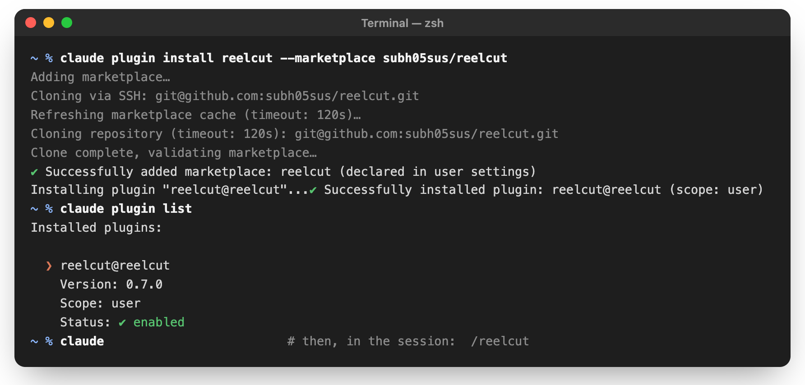
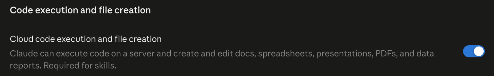
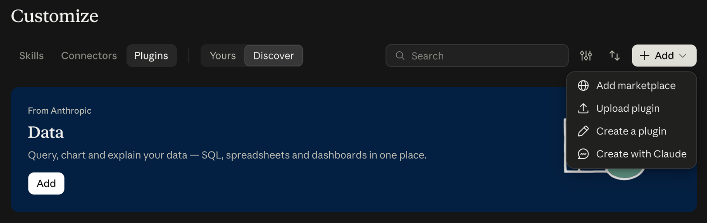
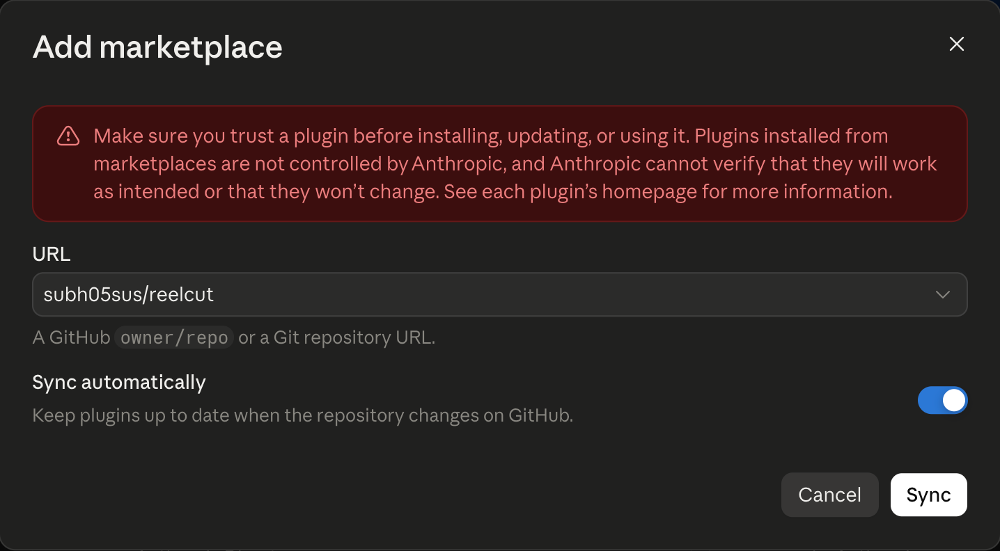
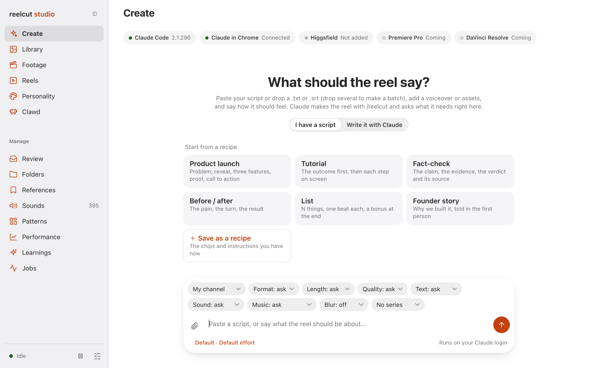
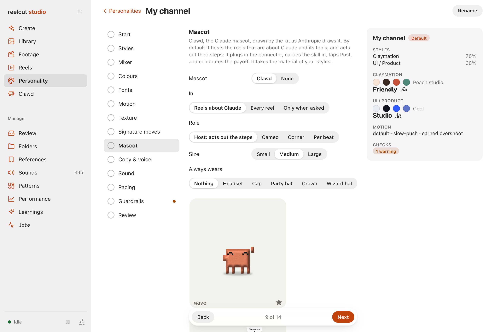
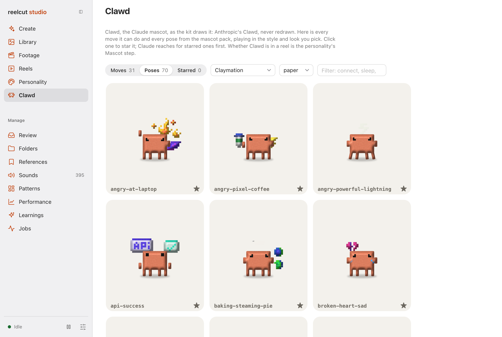

# reelcut

**A script goes in. A folder of motion-graphics clips comes out.**

<p align="center">
  
  <br />
  <sub>The thumbnail reelcut picked for <a href="examples/notiz-apps">its example reel</a> — the hook, fully settled, chosen and baked in automatically.</sub>
</p>

`reelcut` is a Claude Code skill. Give it a spoken script — plain text or an `.srt` — and it
segments it into beats, finds and verifies the assets each beat needs, captures real product
screens, sources data for any charts, composes every beat as HTML + GSAP, and renders one clip per
beat plus a master cut.

Its central bet: the quality comes from the model composing each beat against a few hard rules,
not from pouring text into templates. Rendering is [HyperFrames](https://hyperframes.heygen.com/).

**There is no model API key.** The agent running the skill is the director.

> **Status.** The pipeline runs end to end: a script becomes beats, composed beats become a
> HyperFrames project, and the project renders to per-beat clips and a master with an automatic
> thumbnail. Data sourcing and charts are specified but not built. See
> [What works today](#what-works-today).

---

## Contents

- [Getting started](#getting-started)
- [Connect reelcut to Claude](#connect-reelcut-to-claude)
- [Invocation and every option](#invocation-and-every-option)
- [Creative direction](#creative-direction)
- [The steps](#the-steps)
- [Handing it assets](#handing-it-assets)
- [The gates](#the-gates)
- [Running the pieces yourself](#running-the-pieces-yourself)
- [The rules it will not bend](#the-rules-it-will-not-bend)
- [What works today](#what-works-today)
- [Layout](#layout)

---

## Getting started

### 1. Prerequisites

```bash
node --version            # 22 or higher
ffmpeg -version           # must resolve
npx hyperframes doctor    # Node, FFmpeg, FFprobe and Chrome must be green
```

`doctor` also lists optional things (whisper, Kokoro TTS, MusicGen, Docker). Those can stay red —
`reelcut` does not use them.

<details>
<summary>Installing what is missing</summary>

**Node 22**
```bash
nvm install 22 && nvm use 22          # nvm / nvm-windows
```

**FFmpeg**
```bash
choco install ffmpeg -y               # Windows, from an Administrator terminal
brew install ffmpeg                   # macOS
sudo apt install ffmpeg               # Debian/Ubuntu
```
Open a new terminal afterwards so `PATH` refreshes.

**Chrome** — `npx hyperframes browser ensure` downloads `chrome-headless-shell`. Capture reuses it,
so a machine set up to render is set up to capture.
</details>

### 2. Install the skill

```bash
claude plugin install reelcut --marketplace subh05sus/reelcut
```

Or, in a Claude Code session, `/plugin marketplace add subh05sus/reelcut` then `/plugin install reelcut@reelcut`,
then `/reload-plugins`. The desktop app, VS Code, claude.ai and other agents:
[Connect reelcut to Claude](#connect-reelcut-to-claude).

### 3. Run it

```text
/reelcut
```

On its own, `/reelcut` opens the studio's **Create** page (starting the studio if it is not running): paste the
script, set the options as chips, and make the reel by chatting with Claude there. The same from a terminal:
`npm run dashboard`.

```text
/reelcut script.txt
```

With a script, it makes the reel right here in the conversation, as always; everything else is optional. Add
`--studio` to hand the script and its options to a new Create chat in the dashboard instead.

### Commands

`/reelcut <command>` or, with reelcut installed as a plugin, `/reelcut:<command>` (same thing, with autocomplete).
From a terminal: `npm run reelcut -- <command>`, or `~/.reelcut/bin/reelcut <command>` from any folder.

| Command | |
|---|---|
| `start` · `stop` · `restart` | the studio, in the background; stop and restart ask first while a reel is being made (wait, stop now, cancel) |
| `status` | the studio, reels being made with their progress, the batch, review links, the tools |
| `open [page \| reel]` | `open performance`, `open slop` |
| `list` · `continue [reel] [message]` | recent reels, numbered; carry one on in the studio |
| `new <script>` · `batch <folder> [--tonight]` | hand a script to a Create chat; queue a folder of scripts, unattended |
| `share [reel] [--days 1\|7\|30]` · `shares` · `unshare` | review links (copied to the clipboard) |
| `edit <beat> <change>` · `rerender <beats>` | `edit 3 calmer`, `edit 5 style swiss`, `edit 2 text "Ship it"`, `rerender 3,5` |
| `doctor` · `update` · `clean` · `logs` · `help` | check what reelcut needs; pull, install, test, restart; free disk space (asks what); read logs |

A reel is named by its number from `list`, by part of its title, or left out for the latest.

---

## Connect reelcut to Claude

reelcut renders on your own computer: it needs Node, FFmpeg, Chrome and HyperFrames next to it. Where Claude
runs decides how much of it works.

| Where | Install with | What works |
|---|---|---|
| **Claude Code in a terminal** | `claude plugin install` | everything: reels, the studio, captures |
| **Claude desktop app, Code tab** (local session) | **+** → **Plugins** | everything, same as the terminal |
| **VS Code** · **JetBrains** | `/plugins` · the terminal steps | everything |
| **claude.ai**, the desktop app's **Chat**, mobile | **Customize → Plugins** | planning and writing scripts; it can't render there |
| **Claude Code on the web** (claude.ai/code) | the repo itself | untested, not recommended (see below) |
| **Other agents** (Codex, Cursor, …) | `npx skills add` | the skill; the studio's Create page needs Claude Code |

Everything below assumes the [prerequisites](#1-prerequisites) are installed. Check them at any time with
`/reelcut doctor`.

### Claude Code in a terminal

In a shell (Claude Code 2.1.292 or later):

```bash
claude plugin install reelcut --marketplace subh05sus/reelcut
claude plugin list        # reelcut@reelcut … enabled
claude                    # then, in the session: /reelcut
```

<p align="center">
  
</p>

Or inside a Claude Code session:

```text
/plugin marketplace add subh05sus/reelcut
/plugin install reelcut@reelcut
/reload-plugins
```

`/plugin install` asks where to install it: **user** (every project — pick this one), **project** (shared with
everyone on this repo, through `.claude/settings.json`) or **local** (this repo, only you). Since Claude Code
2.1.275 the two lines can be one: `/plugin install reelcut --marketplace subh05sus/reelcut`.

Then type `/reelcut`. Its commands also autocomplete as `/reelcut:<command>` (`/reelcut:doctor`,
`/reelcut:status`, …).

**Updates.** Marketplaces you add yourself don't update on their own. Run
`claude plugin update reelcut@reelcut` (or `/plugin` → **Marketplaces** → turn on auto-update), then
`/reload-plugins`. `/reelcut update` does the same for a checkout.

**Releasing (maintainers).** Claude Code keeps one copy of an installed plugin per version, so new commits reach
people who already installed reelcut only when the version changes. Bump `version` in
`.claude-plugin/plugin.json` and `package.json` together (`npm version minor --no-git-tag-version` sets
`package.json` and the lockfile); `test/plugin.test.ts` fails while they disagree.

### Claude desktop app — the Code tab

The Code tab runs its own Claude Code, and it reads the same settings as the terminal, so **a user-scope install
from the terminal is already there**. To install from the app instead:

1. Open the **Code** tab and start a **Local** session in any project folder (plugins don't load in cloud or
   WSL sessions).
2. Click **+** next to the prompt box → **Plugins** → **Add plugin**.
3. Add the marketplace `subh05sus/reelcut`, pick **reelcut**, and install it for **user**.
4. Type `/reelcut` in the prompt.

**+** → **Plugins** → **Manage plugins** turns it off, updates or removes it.

### VS Code and JetBrains

**VS Code** (the Claude Code extension): type `/plugins` in the prompt → **Manage plugins** → **Marketplaces** tab,
add `subh05sus/reelcut` → **Plugins** tab, install **reelcut** for **user**. It shares its settings with the
terminal and the desktop app, so a plugin installed in one is in all three.

**JetBrains**: the plugin runs Claude Code in the IDE's terminal, so use the [terminal steps](#claude-code-in-a-terminal).

### claude.ai, the desktop app's Chat tab, and mobile

Here Claude runs in Anthropic's sandbox, which has no FFmpeg, Chrome or HyperFrames, so **it can't render**. It
is still useful for planning a reel: segmenting a script into beats, choosing options, writing the hook. Install it
once on your account and it is in every chat, on the web, the desktop app and mobile:

1. Turn on **Settings → Capabilities → Cloud code execution and file creation** (skills need it).

   

2. Open **Customize → Plugins** ([claude.ai/customize/plugins](https://claude.ai/customize/plugins)) and click
   **Add → Add marketplace**.

   

3. Choose **Add from a repository**, type `subh05sus/reelcut` and pick **Use "subh05sus/reelcut"**. Leave
   **Sync automatically** on so new versions arrive by themselves, and click **Sync**.

   

4. Find **reelcut** in the marketplace's plugins and add it. In a chat, ask for it by name: *"Use reelcut to
   cut this script into beats."*

No GitHub access, or a fork of your own? **Add → Upload plugin** takes a zip of the repo (one
`.claude-plugin/plugin.json` at its top; uploads are limited to 5,000 files and 200 MB, and reelcut is well
under). A plugin installed on your account also syncs to Claude Code as `reelcut@synced` at its next session;
if you already installed it there as `reelcut@reelcut`, turn one of the two off.

### Claude Code on the web

Sessions at claude.ai/code run in a fresh Linux VM that clones the repo you pick. It doesn't load plugins you
installed locally, but it does load a repo's own `.claude/skills/`, and the reelcut repo ships
`.claude/skills/reelcut`, so a session on a clone or fork of reelcut has the skill. To give it something to render
with, set the environment's setup script to:

```bash
apt update && apt install -y ffmpeg
npx -y hyperframes browser ensure || true
```

(the session then runs `npm ci` in the repo) and its network access to **Custom**, with the defaults plus `cdn.jsdelivr.net` (renders load GSAP from it). The
studio isn't reachable from there and the clips stay on the VM, so this is untested and not recommended: use the
terminal or the desktop app.

### Other agents, or a checkout

```bash
npx skills add https://github.com/subh05sus/reelcut --skill reelcut
```

Or copy `skills/reelcut/` into `~/.claude/skills/reelcut/` and restart. The repo also ships `.claude/skills/reelcut`
and `.agents/skills/reelcut` symlinks for agents that scan those paths.

Working on reelcut itself: `ln -s "$PWD" ~/.claude/skills/reelcut` from the checkout (Claude Code loads it as
`reelcut@skills-dir`, live from the checkout), or `claude --plugin-dir .` for one session.

### The studio: your Claude login, and what it connects to

`/reelcut` opens the studio at http://localhost:5198. Its **Create** page makes reels by talking to Claude Code
through the Agent SDK with **your own Claude login** — no API key. If it says you are signed out, run `claude` in a
terminal once and use `/login`.

<p align="center">
  
</p>

The bar above the chat shows what reelcut can reach. Hover an item for how to set it up:

- **Claude Code** — the CLI the studio drives. `claude --version` must work in the terminal that started the studio.
- **Claude in Chrome** — real screen captures of web products. Install the Claude in Chrome extension, sign in,
  then run `/chrome` in a Claude Code session to connect and turn it on.
- **Higgsfield** (optional) — AI video for atmosphere beats. Add the Higgsfield MCP to Claude Code
  (`claude mcp add …` with the server address from Higgsfield), then `/mcp` in a session to sign in.

Then set up how your reels look on **Personality** (styles, motion, sound, and the mascot), and meet Clawd on its
own page:

<p align="center">
  
  <br />
  
</p>

### If it doesn't show up

| Symptom | Fix |
|---|---|
| `/reelcut` isn't in the list | `/reload-plugins`, or start a new session; `claude plugin list` should say *enabled* |
| `claude plugin install` is an unknown command | update Claude Code (`claude update`), or use the `/plugin` steps in a session |
| the install says its packages are not installed | `claude plugin update reelcut@reelcut`; from a checkout, `npm install` |
| the studio's Create page says you are signed out | `claude` in a terminal, then `/login` |
| a render fails at once | `/reelcut doctor`, then `npx hyperframes doctor` |
| plugins are missing in the desktop app | the session is in the cloud or WSL; start a **Local** one |

---

## Invocation and every option

```text
/reelcut script.srt --format vertical --text minimal
/reelcut script.txt --short --look "Swiss print annual report"
/reelcut script.srt --text none --visuals "real product screens, no abstract shapes"
/reelcut script.txt --palette "#0a0a0a #f2efe9 #ff4b1f" make it feel like a late-90s broadcast
```

| Option | Values | Default |
|---|---|---|
| `--format` | `1:1`, `9:16`, `16:9`, `4:5` | `1:1` |
| `--short` | flag — cut to 15–25s instead of the whole script | whole script |
| `--fps` | | `30` |
| `--assets <dir>` | where to look for files you already have | `assets/in/` |
| `--no-data` | skip data sourcing and charts entirely | data on |
| `--text` | `full`, `key-lines`, `minimal`, `none` | depends on voiceover |
| `--motion` | `restrained`, `default`, `energetic` | `default` |
| `--palette` | `"#ground #ink #accent"` | taken from the source |
| `--look` | freeform art direction | inferred |
| `--visuals` | freeform register steer | inferred |
| `--voiceover <audio>` | the recorded read: it sets every cut | none |
| `--blur` / `--no-blur` | camera motion blur | asked |
| `--4k` / `--hd` | render resolution | asked |

**Anything else you type is kept as freeform direction** and carried into the plan verbatim.
*"Make it feel like a museum exhibit"* is real direction that no flag will ever capture.

**Input.** An `.srt` gives exact beat timings. A `.txt` is estimated from words per minute —
workable, but if the voiceover already exists, use the SRT, or better, the recording itself (`--voiceover`).

---

## Creative direction

### `--text` — how much of the script appears on screen

| | |
|---|---|
| `full` | every line on screen; type carries the piece |
| `key-lines` | only the turns of the argument — hook, claim, payoff |
| `minimal` | a label per beat at most, three words or fewer |
| `none` | no text at all; the voiceover carries every word |

**The default depends on whether there is a voiceover.** An `.srt` means spoken audio, so the
default is `key-lines`. A plain `.txt` defaults to `full`.

This is the axis most worth thinking about. A silent video has no choice — type must carry
everything. These reels have a voice, so putting every line on screen makes the viewer read the
sentence they are already hearing, and spends the whole frame doing it.

`none` is not a gimmick. With the words handled by the voice, the frame is free for the product,
the data and the motion — and the reading floor stops applying, because there is nothing to read,
so the cut can move considerably faster. It asks more of the visuals, which is the point.

### `--motion` — how much moves

`restrained` · `default` · `energetic`. Affects entrance durations, stagger spacing, how many
elements move at once, and how much secondary motion a beat carries. It does **not** affect how
long a line stays on screen.

### `--palette`, `--look`, `--visuals`

`--palette` takes three hex values in order. When given, every beat must use them — a beat that
quietly picks its own is a finding, not a variation.

`--look` names one of six looks — `paper`, `ink`, `flood`, `sky`, `cinema`, `poster` — or is
freeform art direction ("warm editorial", "late-90s broadcast") translated into the nearest one.
`--visuals` steers the register ("lots of real product screens", "data-forward", "typographic only").

### Direction is enforced, not suggested

`checkBriefAgainstDirection` only ever *adds* constraints. There is no setting that makes a brief
legal which the base validator rejected — "fast and punchy" is not permission to pull a line off
screen before it can be read.

---

## The steps

The skill stops at each gate rather than pushing through.

### 0 · Ask before cutting

Once the script is segmented, it asks — one or two rounds of multiple choice — about everything you
did not already say: how much text goes on screen, full length or a short cut, the palette and
look (proposed from the script's own product when it names one), motion, format, sound, motion
blur, HD or 4K, and whether to open the studio when the reel is done. Options are tailored to the script, with a
recommendation first. Anything you gave as a flag or in plain words is never asked again, and an
unattended run skips the questions and records the defaults.

### 1 · Script to beats

Parses and segments the script, then writes a `BeatBrief` per beat — intent, the verbatim lines,
emphasis, what must be shown, the composition idea, phases, palette.

Every brief is validated: emphasis may only quote words the script actually says, every line must
fit its reading floor inside its beat, phases must be ordered and start near zero so no beat opens
on a still frame, and ink must be legible on ground.

Beats whose line cannot be read in the time available are marked `TIGHT` — a decision for you, not
a faster animation.

### 2 · Acquire

`mustShow` becomes asset requirements, resolved in order: files you already provided → a capture
of the real product screen → the brand's own source for a mark → drawn, but only if it is generic.

`assetKind` decides what is allowed. **identity** is a specific real thing — a named company's
logo, a real UI — and can never be drawn. **generic** is conceptual and never stalls the reel.

Where a beat shows a real step being done ("download Claude", "add the MCP", "upload this skill"), the
requirement is **footage**: a moment of a screen recording, used exactly as recorded. See *Footage* below.

### 3 · Data and charts

Only when the script states a figure. Finds a source, quotes it verbatim, re-fetches to confirm the
quote is still live, and presents claim + source + quote + check result for your approval.

A chart renders from approved data only, and prints its source on the frame.

### 4 · Compose

One HyperFrames sub-composition per beat — HTML, scoped CSS, one paused GSAP timeline — written for
what that beat says rather than picked from a layout menu.

It composes on a design system built from a review of 809 launch films on
[whatships.com](https://whatships.com): seven looks, one sans + one italic serif + mono, real-looking
UI pieces (prompts, agent steps, windows, phones, code, toasts, cursors, switches, rings, key caps),
Apple-style Liquid Glass for the control layer, and motion helpers that do what those films do —
words resolving out of blur, values rolling in place, text decoding out of noise, a cursor that curves
and clicks and causes something, a slow camera push under everything. A beat opts in with
`data-look="paper"` on its root. Forty-one reference patterns in `skills/reelcut/assets/patterns/`
show each recurring move done properly — illustration, kinetic type, eight product-UI components,
four data components, four type and brand moments — on one grid; `npm run render --
examples/patterns/reel.json` renders them all, and `npm run measure` checks any beat's layout to the
pixel.

The registers available: type, a real product surface, a simulated interaction, a number that
resolves, a diagram that builds, footage, a logo moment. Plus the structural half — depth, masking,
scale change within the beat, texture.

The [HyperFrames registry](https://hyperframes.heygen.com/) has roughly 400 ready blocks and
components — charts, terminals, device frames, maps, film grain, glitch, shimmer sweeps — and the
skill searches it before hand-building anything named.

### 5 · Render and deliver

```
out/
  clips/beat-03.mp4 …   one per beat — drop these into your edit
  master.mp4            all of them, hard cuts
  poster.jpg            the strongest settled frame, baked as frame 0
  plan.md               the beats, the direction, what each beat does
  report.md             every asset and every number, with its source
  project/              kept, so a single beat can be re-rendered in seconds
```

---

## Handing it assets

Three ways, in the order the skill tries them.

**Drop them in the conversation.** Paste or attach. Matched against what the script needs before
anything is searched for.

**Put them in a folder.** `--assets ./logos`, or the default `assets/in/`. Name files after what
they are — `claude-logo.svg` matches a requirement called "Claude Logo" exactly and is used without
asking. A vaguer name still matches, but as a proposal you confirm. One file answers at most one
requirement, so a single PNG cannot quietly fill two slots.

**Let it fetch them.** Brand marks come from the brand's own press page with the licence recorded.
Product screens are captured live.

### The library: acquire once

Everything accepted can be kept in `~/.reelcut/library` with its source and tags, and every later
reel checks there first. An exact match with a recorded source is reused without asking; a capture
older than 90 days, or an asset with no source, is only proposed. Superseded assets are never
offered.

```bash
npm run library -- add assets/in/claude-logo.svg --kind identity --tags claude,logo --url https://www.anthropic.com/brand
npm run library -- list --tags chatgpt
npm run library -- tag <id> +openai -old
npm run library -- supersede <old-id> <new-id>
```

A composition uses one as `assets/library/<id>.<ext>`; the render copies it in and records the use.

### The studio

```bash
npm run studio          # http://localhost:5198
```

A local page, and the place everything you keep lives. It listens on 127.0.0.1 only, and only serves
files from the library or from a recorded reel's folder.

- **Create** — make a reel by talking to Claude. Paste or drop a script (.txt / .srt), add a voiceover or
  assets, set personality, format, length and quality as chips, and send: Claude Code runs `/reelcut` with
  **your own Claude login** (the Agent SDK; never an API key) and the chat shows its replies as they stream,
  its steps (collapsed), frames and clips as they appear, and its questions as cards you answer right there.
  Edits and commands inside the project run freely; anything outside, or outward-facing, asks you first.
  Conversations are saved and resume the same session ("make beat 3 calmer"); runs keep going if you close
  the tab, with a notification when Claude needs you or the reel is done.
- **Personality** — how every reel looks, moves and sounds: up to three of twenty styles with their colours
  and type, motion, texture, signature moves, mascot, voice, sound, pacing and guardrails.
- **Clawd** — the Claude mascot's moves and the mascot pack's poses, all playing live in any style and look; star
  the ones you like and Claude reaches for them first. See *Clawd* below.
- **Library** — every asset, filterable by type (images, vectors, video, sounds) and tag, with its
  source, preview, measurements and editable name, tags, kind and status. **Drop files or whole folders
  on the page** and each one is checked (by its bytes, never its extension), previewed, measured and
  tagged on arrival.
- **References** — films you admire, measured for how they cut and look; Claude tags the moves, you accept,
  and a rule is proposed when three or more agree. Never used in a reel.
- **Footage** — screen recordings: scrub one, mark the steps in it as named moments, zoom regions per reel
  format (drawn on the video), tick that you checked it for private information, and see what is ready to be used. See *Footage* below.
- **Review** — what was dropped in waits here. Nothing in it can be used by a reel on its own until you
  approve it, singly or in batches; the machine's and Claude's tags show in *italics* until you have.
  Nothing is ever inferred to be a real brand mark: only you set that.
- **Folders** — point it at a folder (a Google Drive, Dropbox or OneDrive folder is just a place on this
  computer) and new files are ingested while the studio runs, with a rescan as a backstop. Per folder:
  a kind, *trusted* (skip review), *private* (never shown to Claude), pause, rescan. It reads these
  folders and never writes to them. **A pause button at the top of every page stops all of it** — nothing
  is read, scanned or indexed until you resume — and it holds if the studio restarts
  (`npm run library -- pause|resume`).
- **Learnings** — what the studio has noticed about your taste, as plain rules you can read, edit, pin,
  switch off, delete, write yourself, export and import. Claude reads only the rules that are on, and
  lists the ones it applied in each reel's plan. See [learnings.md](skills/reelcut/references/learnings.md).
- **Reels** — every render, with the master, each clip and the report, and **Works / Not quite** and a
  note on every beat: the clearest signal the studio gets.
- **Jobs** — re-renders started from a clip's button, one at a time.

What was dropped in and cannot be understood by a script (is it the real Claude mark, or a screenshot
of it?) waits in a queue for Claude: run `/reelcut tag-assets`, and Claude views each preview and writes
tags and a description. Claude suggests; it can never approve, and never marks an asset as an identity
asset.

**Sound effects** are the same kind of asset: drop your own sounds in, and each is measured (length, peak,
loudness), given a waveform, and tagged with guesses from its shape (click, whoosh, riser, hit…). Once
approved, `npm run sfx -- suggest reel.json --apply` proposes cues for each beat's own moments (a click, a
typing run, a count, a reveal) from your library, and `--sfx` plays them. No sounds ship with reelcut.

```bash
npm run library -- ingest <file-or-folder>…           # one-off, from the command line
npm run library -- folders add <path> --label "Brand kit" [--trusted] [--private]
npm run library -- queue | annotate | review          # the Claude queue, and a person's decisions
npm run sfx -- list | find --event click | suggest reel.json [--apply]
npm run learnings -- brief | list | accept <id> | export | import
```

### Higgsfield — optional, fast, with an automatic fallback

If the Higgsfield MCP is connected, Step 0 can offer to generate the beats that are honestly *atmosphere* — a
background of moving light, an abstract idea, a gentle move on a still — with AI video, which is faster than
composing them. A beat that needs a real product, mark, screen or recorded step is **never** generated. If it is
not connected, or it is set to *never* (a select in the studio's header: ask each reel / always / never),
nothing is asked and every beat is composed in HyperFrames; if a generation fails, times out or runs out of
credits, that beat falls back to HyperFrames and the reel logs it.

```bash
npm run generate -- plan --beats beats.json --connected yes     # which beats, why, and whether to ask
npm run generate -- prompt --mode atmosphere --subject "the quiet hour before a launch" --seconds 4.4
npm run generate -- add clip.mp4 --model "Veo 3" --prompt "…" --beat beat-01 --job <id> --credits 12
npm run generate -- record beat-01 --manifest out/reel.json --outcome generated|fallback|skipped
```

A generated clip is generic (never identity), is used as soon as it is registered (no approval step), is placed under real
HyperFrames type, is labelled AI-generated, and is saved so re-rendering never calls Higgsfield again. At most 6
clips a reel. See [generate.md](skills/reelcut/references/generate.md). The Higgsfield tools were not
connected where this was built, so the live call is Claude's, untried here; everything around it is tested.

### References — learning motion taste from films you admire

Drop motion-graphics films you like on the studio's **References** tab. Each is measured (how it cuts: median
shot, cuts a minute; whether its ground is light, dark or a brand colour; colours; how much moves), and
`/reelcut study-references` has Claude tag the moves it sees from the fixed whatships vocabulary. When at
least three references agree, a rule such as *"Your references mostly cut fast (median shot under 1.6s)"* is
**proposed** in Learnings; nothing changes a reel until you switch it on. References are third-party films:
they have their own index, apart from the library, are never placed in a reel and never leave this computer.

```bash
npm run references -- add film.mp4 other-films/
npm run references -- queue | annotate | brief
```

See [reference-videos.md](skills/reelcut/references/reference-videos.md).

### Footage — real recordings, used as recorded

Where the honest picture is a recording of something happening, reelcut places the recording instead of
animating a copy of it. Drop a screen recording on the studio's Library page; it is measured, previewed and
given a **filmstrip** of eight frames across it. In the **Footage** tab you scrub it, mark the steps in it as
named **moments** ("download Claude", 0:02 to 0:08.5), or let Claude index them from the filmstrip. A script
line is then matched to a moment, not a file.

```bash
npm run footage -- list
npm run footage -- find "download Claude" --platform mac
npm run footage -- fit <asset>:<moment> --seconds 4.4        # does it fit the beat, will its text be readable
npm run intake -- --requirements out/requirements.json      # a requirement with "form": "footage" finds moments
```

What may be done to a recording: trim it to a moment, frame it in a rounded window, zoom into a region of
it, play a long step faster (one even rate, at most 2x), hold its last frame, and annotate over it with a
ring or a glass step pill. Never redraw it, edit inside it, slow it down or loop it. The beat's length is the
voiceover's: the recording adapts, and a moment that would need more than 2x is refused with its ways out
rather than quietly cut. Nothing needs approving: a recording, and the moments Claude indexes from its filmstrip
(`/reelcut tag-footage`), are used as soon as they match. Only a first use, a recording over 90 days old or a
weaker match is asked about once. Nothing can be masked in a recording, so a private detail in one is only
flagged in the report.

**Green screens.** A recording on a flat green backdrop is detected when it comes in and keyed, once, into a
transparent WebM saved beside it (the original is untouched): the green is removed from the backdrop reached
from the frame's border, soft edges keep their partial transparency with the green taken back out of them, a
soft drop shadow on the green stays as a soft shadow (or is removed, per recording), and each moment is cropped
to the card in it. The Footage tab shows original and keyed on a checkerboard, with tolerance, softness, despill,
shadow and edge controls; `npm run footage -- key <asset>` does the same from the command line. Place one with
`data-frame="cutout"` (see the `footage-cutout` pattern). Details, and the three ways it can go wrong, in
[footage.md](skills/reelcut/references/footage.md).

### Voiceover — the read sets the cut

Hand it the recording and each beat's spoken text, and `npm run voice -- reel.json` transcribes it on your machine
(whisper.cpp, German included; nothing is uploaded), matches the transcript to the text even where a name was
misheard or a number spelled out, moves every word's edges onto the voice's real pauses, and cuts each beat in the
pause just before its first word. The compositions then get their own words: `RC.word("Claude")` is the moment
"Claude" is said, so a headline resolves on the word that names it, and `RC.voiceDrive` moves a shape with the
speaker's loudness.

### The mix — designed, not stacked

Clips render silent and the reel's sound is mixed once: each cue lands by its transient, its peak (whooshes) or
its end (risers, so they arrive on the cut); repeated sounds vary a touch in pitch and pan; effects duck 7 dB and
music 9 dB under the voice; the whole is normalised to -14 LUFS, true peak -1.5. Every clip carries its slice of
that mix, the master all of it, and `mix/` keeps the stems (effects, voice, music) for an editor.

### Motion blur and 4K — asked per reel

Motion blur renders four sub-frames per frame and blends them like a camera's 180° shutter: fast moves smear
along their path, still frames stay sharp. 4K renders the same layout at twice the pixels (1:1, 9:16, 16:9).
Both are Step 0 questions, stored in `reel.json` as `"render"`, and `--no-blur` / `--hd` make a quick draft.

### Clawd — the Claude mascot, as the host of reels about Claude

Most of these reels are about Claude and its tools, so Clawd, Anthropic's Claude mascot, can host them: it walks in under
the hook, acts out each step — plugs in the connector, carries `SKILL.md` into the chat, taps Post, jumps to reach a
button out of reach — celebrates the payoff with a confetti stomp, and holds up the word of the call to action. The
kit draws it from one fixed spec (Anthropic's minimal Clawd: an 8 × 6 body, square eyes, no mouth, `#d97757`) and moves
it the way Anthropic's own Clawd clips do — a crouch before a hop, a gravity arc, legs that step, poses that hold —
while everything around it stays on Apple's springs. It never redraws it.

- **When:** the personality's Mascot step; by default Clawd hosts the reels that are about Claude (`npm run clawd --
  check script.txt` says whether one is, and what Clawd could do in each beat). Step 0 says so in one line.
- **Any style:** it takes the beat's material — clay in Claymation, a cut card in Paper Cutout, an outline in Linear, a
  voxel in 3D, goo in Liquid, a chroma split in Glitch — and an ink outline by itself on a ground too close to its orange.
- **More than 30 acts:** walk, hop, look, wave, point, tap, plug, carry, type, say, sign, think, the confetti stomp, a
  flag, a workout, sleep and wake, reactions, costumes (party hat, headset, crown…) and props (phone, laptop, plug,
  calendar…), subagents as mini Clawds, a hatching egg, and acts on the voiceover's words.
- **70 poses** from the mascot pack, re-cast onto the minimal Clawd with their props and effects animated: a lightbulb
  that pulses, Z's that rise, an alert that flashes.
- **Its own 8-bit blips** for every act, synthesised for reelcut (CC0), placed by `sfx suggest`.
- **Overlay clips** for your own editor: `npm run clawd -- overlay wave --style claymation --format mov` (ProRes 4444
  with alpha).

```bash
npm run clawd -- check script.txt        # is it about Claude, and Clawd's part in each beat
npm run clawd -- poses --tag sleep       # the pack's poses
npm run clawd -- overlay all --format webm
```

How to compose with it: [references/clawd.md](skills/reelcut/references/clawd.md); seven beats with Clawd in
`skills/reelcut/assets/patterns/clawd/`. Clawd is Anthropic's character; reelcut draws it for reels about Claude and is
not affiliated with Anthropic.

### Sounds — 395 CC0 motion-graphics sound effects, bundled

Whooshes, risers, reverse swells, slides; clicks, single keystrokes, typewriter strikes, typing runs, toggles, dings, chimes, error buzzes; pops; punches,
thuds, booms; glitches, zaps, shimmers; and Clawd's own 8-bit blips. All CC0 (Kenney's audio packs and CC0 sets from
OpenGameArt, each licence checked, and the blips reelcut synthesises itself; credits in `skills/reelcut/assets/sfx/CREDITS.md`), trimmed, normalised so nothing clips, and measured so
each sits at the same level in the mix. `npm run sfx -- suggest reel.json` picks them for the moments the kit
records (clicks, typing, counts, reveals, cuts) alongside your own approved sounds, which win a tie. Typing is
placed as keystrokes, about one per 2.6 letters with a human swing, each a different key. Hear them on the
studio's **Sounds** page.

```bash
npm run sfx -- list --pack --category transition
npm run sfx -- find --event riser
npm run sfx -- suggest out/reel.json --cuts --apply && npm run render -- out/reel.json --sfx
```

### Type — 66 bundled fonts, in 18 pairings

Every font ships with the skill (open licences, files in `skills/reelcut/assets/fonts`), so a render needs no
network and looks the same a year from now. Each clip carries only the fonts it uses. All 66 families draw
German with their own glyphs (ä ö ü ß „ “ €), checked by `npm run fonts -- check`.

A **pairing** sets the headline, body, accent and mono together: `studio`, `swiss`, `editorial`, `poster`,
`tabloid`, `tech`, `startup`, `luxe`, `friendly`, `brutal`, `expressive`, `crafted`, `handmade`, `signage`,
`classic`, `chunky`, `extended`, `fashion`. Step 0 shows three on your hook line (`npm run fonts -- sheet`) and
the answer goes in `reel.json` as `"type"`. Learnings learn which pairings you keep.

```bash
npm run fonts -- list --kind display
npm run fonts -- pairings
npm run fonts -- sheet --pairings poster,editorial,swiss --text "Größere Ideen"
```

### Your patterns — beats you liked, kept

Rate a beat **Works** in the studio and it is kept as your own pattern: its layout, motion and timing, with the
words, numbers, assets and recordings marked as slots to replace. The next reel starts from your patterns first,
best-rated first, and a pattern climbs when beats made from it are rated well. Rating the beat **Not quite** takes
it back out, unless you renamed or tagged it. The studio has a Patterns view; `npm run patterns -- list` too.

### Music — a bed that lands on the cut

A track long enough to be a bed is measured when it comes in: tempo, every beat, bar lines, phrases, mood words.
Step 2 finds one in this order: your library → a free-licence site (Pixabay Music, Free Music Archive CC0/CC-BY,
Incompetech), saved with its page, licence and credit → generated with Higgsfield, labelled AI-generated.

Two ways to lay it, chosen per reel: **fit** keeps every cut and starts the track where most cuts land on beats;
**snap** also moves each cut onto the nearest beat (at most 0.15 s; with a voiceover the voice owns the cut and the
track fits instead). It goes into the mix at about -16 LUFS, ducks under the voice, and is kept alone as
`mix/stem-music.wav` for an editor.

```bash
npm run music -- find --mood upbeat --bpm 100-130 --min-seconds 60
npm run music -- add track.mp3 --licence "Pixabay Content License" --url https://… --credit "Artist – Title"
npm run music -- plan out/reel.json --sync snap
```

### When something is missing

It will not stall silently:

```
1 open requirement, 1 of which stops the reel.

BLOCKS  ChatGPT chat screen — could not be acquired (login wall)
        needed for: The breadth beat
        A specific real thing — it cannot be drawn.
        1. Capture it from the live product — needs a URL, and a sign-in
        2. Drop the file in — needs a file in png
        3. Use another library asset in the same role
        4. Compose the beat without it
```

Option 4 is always present, so a gap is never a dead end. A brand logo will **never** be drawn to
fill one.

---

## The gates

Each one exists because its absence produced a defect that shipped.

| gate | what it refuses |
|---|---|
| **Reading floor** | a line scheduled into less time than it takes to read |
| **Brief validation** | invented emphasis, unordered phases, a beat opening on a still frame, illegible ink |
| **Legibility** | a capture that will render below 11px at the size it appears |
| **Secrets scan** | a capture holding a real email, IBAN, card number, private host or API key |
| **Consent / login** | a cookie wall or sign-in page passing as a product screen |
| **Required text** | a capture that does not contain what it was supposed to show |
| **`hyperframes check`** | runtime errors, layout collisions, WCAG contrast failures, a frozen composition |
| **Frame checker** | a blank panel — a container that forgot to draw its contents |
| **Provenance** | an asset or a number with no recorded source |

**The legibility gate is arithmetic, not judgement.** The browser knows the smallest computed
`font-size` in what it captured, so:

```
renderedPx = bodyFontPx × (targetWidthInFrame ÷ captureWidth)
```

Below 11px it refuses, and says both ways out — crop to at most N px, or give it at least M% of the
frame. Real output:

```
ILLEGIBLE: body 16px renders at 7.0px (scale 0.44)
  body text is 16px in an 864px capture, which renders at 7.0px at 35% of a 1080px frame —
  below the 11px floor. Either crop to at most 549px wide, or give it at least 55% of the frame.
```

It runs on the **body** size — the smallest that still covers 90% of visible characters — so an 8px
legal footer cannot fail an otherwise perfect capture. A capture with no text passes: a photograph
is not illegible, it has nothing to read.

---

## Running the pieces yourself

Every step is an ordinary script. Useful for debugging, or to sanity-check a script before
committing to a full run.

```bash
git clone https://github.com/subh05sus/reelcut && cd reelcut
npm install
```

### `npm run beats` — script → beats → cut

```bash
npm run beats -- examples/notiz-apps.txt --short
```
```
notiz-apps.txt — 14 beats, 59.6s, durations ESTIMATED from words per minute

  #   secs  floor
   0  6.67  5.40        Notara oder Kettlebrief? Wenn du heute nur eine Notiz-App für deine…
   1  4.80  3.90        Beide sind erstaunlich gut, aber sie fühlen sich beim Arbeiten völlig…
  …

short cut — 4 of 14 beats, 18.2s
  hook      # 0  6.67s  Notara oder Kettlebrief? …
  payoff    #13  4.43s  Wenn du nur eine behalten dürftest, würdest du Notara oder…
```

The example is a fictional comparison of two invented note apps. It has the shape of a real
reel — comparison, contrast, thesis, payoff — without being anyone's actual script.

### `npm run capture` — a product surface, with all four gates

```bash
npm run capture -- https://example.com \
  --selector "body > div" --target-width 0.8 \
  --out assets/in/card.png --must-contain "Example Domain"
```

Writes the PNG plus a `.json` sidecar carrying url, selector, timestamp, element size, body font
size and what it renders at — which is what `report.md` is built from. Exits non-zero on a refusal.

### `npm run intake` — match what you have against what is needed

```bash
npm run intake -- --dir assets/in --requirements out/requirements.json
```

Reports matches with a confidence and everything still open with its ways out. Exits non-zero only
when a gap actually blocks the reel. Reports only — it never moves or renames a file.

### `npm run render` — beats to clips, a master and a thumbnail

```bash
npm run render -- examples/notiz-apps/reel.json [--preflight] [--sfx] [--clips-only] [--master-only] [--only beat-03] [--jobs N] [--blur [N]] [--no-blur] [--4k] [--hd]
```

`reel.json` lists the beats, their durations and their compositions. Every beat renders as its own
project, several at a time (worked out from your cores and memory; `--jobs` overrides), so one broken beat
fails alone and the rest still ship. A beat that cannot render yet (footage that does not fit, a missing
asset) is listed as blocked and the others render around it; `--preflight` lists every blocker in a second
without rendering. Each file then goes through the frame checker, and only files that rendered **and** passed
are reported as delivered. The master is the passing clips **joined**, not rendered a second time, and
`contact.jpg` shows five frames of every beat.

```
4 beats, 18.13s, 1080x1080 @ 30fps, silent · 3 clips at a time, 3 workers each
  beat-00 … ok  (15.2s)
  beat-03 … ok  (23.8s)
  beat-10 … ok  (12.0s)
  beat-13 … ok  (12.9s)
  master … joined (4 clips, 544 frames)
  poster … 6.25s (hook_settled), baked as frame 0 — 544 frames, unchanged

5 of 5 rendered and passed.
```

Three things it checks that would otherwise fail silently:

- **Ids.** A sub-composition whose timeline key does not match its host renders **frozen at t=0**
  with no error. The project is refused instead.
- **Frame count.** Times are written a hair below each frame boundary, so the renderer lands on
  exactly the frame intended. The first version wrote 122 frames as `4.0667` and got 123.
- **The thumbnail.** Frame 0 is replaced — never added to, which would shift every beat — by the
  fullest settled frame of the **hook**, the beat whose job is to say what the video is. Override
  with `"poster": <seconds>` in the manifest.

`--sfx` adds sound effects placed in the manifest, at 0.35 by default adjusted by each sound's measured loudness,
in the render's own mix (above). Off unless asked for.

### `npm run measure` — a beat's layout, to the pixel

`npm run measure -- --all out/reel.json` does the whole reel in one Chrome session and writes one sheet
(`measure/reel-sheet.jpg`, a row per beat) and one list of findings.

```bash
npm run measure -- skills/reelcut/assets/patterns/pricing-toggle.html 4.3 --guides --scan \n  --select ".rc-head||.plan" --bearings ".rc-head .ln"
```

Loads a composition in Chrome with the kit injected, seeks it to each time, and prints layout
rectangles with the camera push off, text baselines, first-glyph side bearings (for optical
alignment to the 84px margin), and — with `--scan` — anything outside the safe area, overflowing, or
under 16px. `--guides` draws the grid over a screenshot. It reports and never fixes.

### `npm run check-video` — the frame checker

```bash
npm run check-video -- out/clips/*.mp4
```

Blank panels are the only hard failure. Static holds and grid ink are reported, never gated: a long
hold on a payoff is the reading floor working, not a defect.

### `npm run watch` — watch any video the way a person does

Claude watches video in a Think-Act-Observe loop instead of reading a fixed stack of frames. It gets a map
first, jumps to the parts that matter, pulls frames at any frame rate, re-watches fast parts at 10 fps, zooms
in to read, and listens to the transcript and the sound, all within a frame budget. Everything runs locally:
ffmpeg, whisper.cpp with voice detection, and macOS Vision for on-screen text.

```bash
npm run watch -- overview demo.mp4 --question "when does he open settings?" --depth normal
npm run watch -- search demo.mp4 "settings" "Einstellungen"     # where it is said, shown on screen, or noted
npm run watch -- frames demo.mp4 --from 1:44 --to 1:56 --count 9 --why "find the settings page"
npm run watch -- frames demo.mp4 --from 1:49 --to 1:51 --fps 10 # the fast part, frame by frame
npm run watch -- zoom demo.mp4 --at 1:49.6 --region top-right   # read the small text
npm run watch -- overview out/master.mp4 --beats out/reel.json --depth deep   # the self-review of a render
```

Also `ocr`, `transcript`, `audio`, `motion`, `scenes`, `note`, `observe`, `clip` (mp4 or gif), `report` (an
HTML watch path), `budget`, `forget`, `fetch` (any yt-dlp link) and `doctor`. reelcut uses it in four places.
Every master is watched before Claude says it is done (a report-only **Self-review**). Reference films are
watched, not read from a contact sheet. Recorded steps get frame-exact in and out points. And the studio's
Create page has an **Ask about a video** mode, with a **Watch** panel that shows where Claude looked. The loop
is in [`skills/reelcut/references/watch.md`](skills/reelcut/references/watch.md). The same thing as a standalone
skill, for any Claude Code: [subh05sus/video-understanding-skill](https://github.com/subh05sus/video-understanding-skill).

### `npm run techniques` and `npm run graph` — what a beat must do, and graphs of systems

Every beat names a technique path, `operation/domain/technique/timing`: what it must **do** (differentiate, group,
sequence, infer, reveal, transform), through which channel, by which move, played how. About 70 techniques are written
in our own words from Gestalt and semiotics, mapped onto the moves and patterns, and scored by your Works ratings.
The framework is inspired by Iris™, *A Taxonomy of Visuals*, by Modern Art Direction; nothing of theirs is used.

```bash
npm run techniques -- suggest --kind data "Über 71.000 Follower in sechs Monaten"
npm run techniques -- ideas "Make our scheduler stand out: it replaces three tools"
npm run techniques -- plan out/reel.json
npm run graph -- atlas --tags screenshot --reels 6       # up to 500 images in one sheet for a graph
```

The kit's graph engine (`RC.graph`) draws systems: worlds the camera flies through, trees whose branches light,
path cards that roll, members that bloom out of a node, and ripples of light that spread from one idea. Five patterns
show it (`graph-world`, `graph-tree`, `graph-path-card`, `graph-bloom`, `graph-pulse`), and the new **Atlas** style is
made for them. The studio has a **Techniques** page (the live graph, examples, pin a technique to a chat), a
**From a brief** mode on Create, and a Techniques step in the Personality. See
[`skills/reelcut/references/techniques.md`](skills/reelcut/references/techniques.md).

For the people using the studio, every technique is said plainly ("Make the number stand out: big, counting up")
and has a **preview clip** in the default personality's look (`npm run techniques -- previews`, or the button on the
Techniques page; made again when the personality changes). **Try a line** shows three ways to show any line, and
draws your own line those three ways in your personality (`npm run techniques -- sketch "<line>" --only a,b,c`). On a
reel, each beat shows its technique and a strip shows the reel's shape; tap a beat to swap its technique or ask for
**3 other ways**, rendered to pick from. A star favours a technique; recipes and series can carry a technique per kind
of beat ("Save how these beats are done as a recipe"); a short tour opens the Techniques page the first time.

**Client board**: a private link where a client approves a reel in stages (directions with their preview clips, the
script and beat plan, the beat drafts, the final reel), approving each item or asking for a change. Claude stops
after each stage and waits for the decision, which comes back into the chat. Asking for a change on a clip can
**mark the frame** (tap to pin, drag to draw); Claude gets the second, where it is, and a still with the marks drawn
on it. Each send keeps its own copies, and an item sent back after a change shows the client **before and now** side
by side with what they asked. **Your brand** (name, colour, a logo from the library) heads every board.

**The hook** (`npm run hook`): every master's first 3 seconds are checked as it is joined (Instagram counts who
scrolls past within 3 s). The check reads the words on each frame with macOS Vision, times when they appear and
when something first moves, holds beat 1's words to the reading floor, and lists any line of the reel's that sits
under Instagram's own interface anywhere in the reel; Claude looks at the strip and adds a verdict and a rewrite
(`hook.json`, `hook/strip.jpg`). The studio's Hook card offers **Fix the hook** and **Make 3 hooks**: three other
openings at beat 1's exact length, each joined into a full master from the existing clips with the real sound, to
use (swapped in, no render) or to post two as an **A/B test**, whose numbers the Post tab records per hook. **Show
Instagram's UI** draws the Reels interface and the profile grid's crop over a 9:16 master, and **Other formats**
has Claude lay the reel out again in 9:16, 4:5 and 1:1 (`formats/<w>x<h>/`), shown above the player.

**Sound** on a finished reel: the music's tempo, how many cuts land on its beat and what snapping would move
(**Put the cuts on the beat** goes to Claude, since beat lengths change), and the sound cues per beat, yours or the
bundled pack's. **Add sound cues** proposes cues for each beat's own moments (never a second sound on a moment that
has one; **Only my own sounds** uses `sfx suggest --mine`) and re-mixes the master and every clip's slice without
rendering a frame. New reels have sound effects on unless the personality or the composer says otherwise.

### `npm test`

```bash
npm test          # 675 tests
npm run typecheck
```

---

## The rules it will not bend

- **Nothing is invented.** Not a statistic, not a logo, not a claim. If the script does not say it
  and no source supports it, it does not go on screen. A generated logo is a fabricated logo.
- **Nothing secret leaves a capture.** Real product screens hold real customer names, addresses and
  invoice numbers. Captures are scanned, masked or rejected, and the report says which.
- **A capture that cannot be read is a failed capture.** Measured, not eyeballed.
- **The reading floor.** A label needs ~0.8s settled on screen; a sentence ~0.3s per word, never
  under 1.2s, counted from when the whole line is visible. The payoff gets the most time, not the
  least.
- **Every beat boundary is a hard cut.** A cross-fade between two compositions ghosts and a wipe
  cuts through type. Settled, not a preference.
- **Frame 0 of every beat is legible.** Opacity leads position, so a hard cut never lands on a
  blank frame.
- **Determinism.** No clocks, no unseeded random, no infinite repeats. Every frame reproducible
  from its time alone.
- **Clawd is drawn only by the kit.** It is Anthropic's character: posed, animated, dressed and lit in the
  style's material, never redrawn, recoloured or reshaped.

---

## What works today

| | |
|---|---|
| Script → beats → short cut | ✅ verified on a 14-beat German script |
| Brief contract and validation | ✅ tested |
| Creative direction | ✅ tested |
| Asset intake and gap reporting | ✅ tested, verified end to end |
| Capture with all four gates | ✅ tested, verified against a live page |
| Beats → HyperFrames project | ✅ tested, including the frozen-render and drift invariants |
| Render → clips, master, thumbnail | ✅ **produced a real 18s reel**, every frame count exact |
| Frame checker | ✅ tested, catches a real blank panel in a third-party video |
| Asset library and studio | ✅ tested; a library asset rendered into a real clip and re-rendered from the studio |
| Design kit and patterns | ✅ forty-one patterns and the example reel render and pass every gate; layout measured to the pixel |
| References (learn motion taste from films) | ✅ tested; real clips measured, three agreeing references proposed rules, driven in the studio |
| Higgsfield (optional AI backgrounds) | ⚠️ plan, gates, registering, placement and fallback tested and rendered with a stand-in clip; the live MCP call is untried |
| Footage (recorded steps, as recorded) | ✅ tested; a recorded moment rendered into a real clip, trimmed, retimed and zoomed, and its frames viewed |
| Sound effects (`--sfx`) | ⚠️ placement and mixing tested; no sound library ships |
| Watching video (agentic: map, search, any-fps looks, zoom, OCR, transcript, sound) | ✅ tested; a real master watched beat by beat, the studio Watch panel shown from a recorded watch session (a live studio run is untried) |
| Techniques taxonomy and graph engine | ✅ tested; five graph patterns rendered and passing every gate, the studio's Techniques page and brief mode shown in screenshots (a live studio run is untried) |
| Technique previews, steering beats, recipes, first-run tour | ✅ tested; all 69 previews rendered and passing every gate, the Techniques page, beat sheet and reel panel shown in screenshots (a live Claude run of "3 other ways" is untried) |
| Hook check, 3 hooks and A/B, Instagram safe zones, other formats | ✅ tested; a real 72 s master checked, a hook variant composed, rendered, joined and swapped in, the Hook card and overlay shown in screenshots (Claude laying out another format live is untried) |
| Sound on a finished reel (beat-snapping, cues, re-mix) | ✅ tested; cues added to a real 72 s reel from the owner's library and the master and clips re-mixed without a render (snapping a real track's cuts live is untried) |
| Client approval board | ⚠️ tested, with marks drawn on a frame in a headless browser, before/now and the owner's brand shown in screenshots through the review server locally; a client reached over the Cloudflare tunnel is untried |
| Clawd, the Claude mascot | ✅ 30+ acts in every style, 70 pack poses, seven patterns rendered and passing every gate, transparent overlays, its own sounds |
| Data sourcing and charts | ⚠️ specified, not built |

---

## Layout

```
skills/reelcut/
  SKILL.md              the router: the steps and the hard rules
  references/           steps 0–5, design system, kit, patterns, direction, sourcing
  assets/kit/           shared looks, UI pieces and motion helpers, injected via data-look (ui/80–82: Clawd)
  assets/patterns/      reference compositions, one per recurring move (clawd/: Clawd's beats)
  assets/clawd-pack/    the mascot pack's 75 pixel poses, re-cast onto Clawd by `npm run clawd -- import`
  scripts/              beats, intake, capture, render, measure, check-video, library (+ studio), sfx, footage, references, generate, learnings
src/
  core/                 reading floor, frame sizes, the Beat schema
  planner/              parse, segment, merge, density, short cut
  brief/                BeatBrief + validators, asset gaps, asset intake
  capture/              legibility gate, secrets scan, Puppeteer capture
  direction/            creative direction and its enforcement
  verify/               the frame checker, and the layout measurer
  render/               project builder, poster choice, the HyperFrames render route
  generate/             Higgsfield: which beats may be generated, the prompt, the plan, registering a clip, the log
  references/           reference films: measurements, tags, and the signals they give the learnings
  library/              the asset library, its reuse and review policy, ingest, watched folders, sound search, and the record of every run
  learnings/            signals, proposed rules, and the brief Claude reads
  clawd/                the mascot pack's conversion, Clawd's moves, its sounds, whether a script is about Claude
  studio/               the local server and its one page
examples/               a script to try it on, and a composed, renderable reel from it
```

`src/` is plain TypeScript with two runtime dependencies (`zod`, `puppeteer-core`). It was ported
out of a larger Remotion pipeline; what came across is the part that was never engine-specific.

## Credits

- Rendering by [HyperFrames](https://hyperframes.heygen.com/).
- Clawd is Anthropic's Claude mascot. Its motion follows Anthropic's own Clawd clips, as taken apart in Ayotomiwa
  Wale-Durojaye's [Codrops article](https://tympanus.net/codrops/2026/05/05/reverse-engineering-claude-ais-mascot-animations-with-svg-and-gsap/);
  its moods and accessories were first seen in [clawd-react](https://github.com/stevysmith/clawd-react); the 70 poses
  come from the mascot pack the owner provided.
